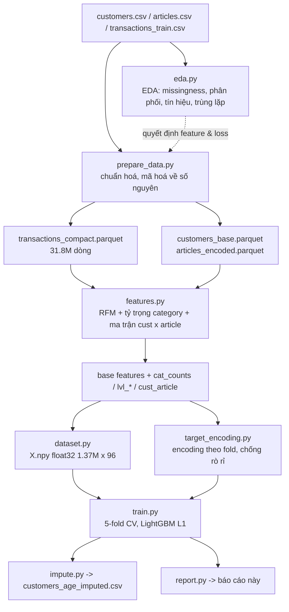

# Age Imputation — H&M Personalized Fashion Recommendations

## 1. Bài toán

| | |
|---|---|
| Khách hàng | 1,371,980 |
| Có `age` | 1,356,119 (98.84%) |
| **Thiếu `age`** | **15,861 (1.16%)** |
| Giao dịch dùng làm feature | 31,788,324 (2018-09-20 → 2020-09-22) |
| Khoảng tuổi | 16–99 |

Mục tiêu: dự đoán `age` cho 15,861 khách thiếu, dựa trên hành vi mua sắm và thuộc tính tài khoản.

## 2. Kiến trúc pipeline



Mỗi bước ghi artifact ra đĩa (Parquet/NPZ/NPY) nên chạy lại không phải đọc lại CSV gốc 3.5 GB.

### Đặc trưng (105 chiều)

**1) Hành vi giao dịch (RFM + xu hướng)** — 24 chiều:
`n_txn`, `n_uniq_art`, `total_spend`, `mean_price`, `median_price`, `max_price`, `std_price`,
`n_days`, `online_share`, `weekend_share`, `n_txn_365d`, `mean_price_365d`, `n_txn_90d`,
`recency`, `tenure`, `txn_per_active_day`, `repeat_item_ratio`, `spend_per_txn`,
`recent_activity_ratio`, `price_trend`, `log_total_spend`.

**2) Thuộc tính khách hàng:** `active_flag`, `Active`, `club_code`, `news_code`.

**3) Tỷ trọng mua theo category articles (72 chiều):** tỷ lệ lượt mua trong từng nhóm của
`index_group_name`, `index_name`, `garment_group_name`, `section_name`, `product_type_name`
(category hiếm gộp vào `OTHER`).

**4) Target encoding theo fold (9 chiều)** — tuổi trung bình (làm trơn Bayes) của người mua,
tính **chỉ trên tập train của fold**:

| Feature | Ý nghĩa | Alpha |
|---|---|---|
| `te_article` | tuổi TB người mua từng `article_id` (105.542 mức) | 10 |
| `te_department_no` | tuổi TB theo department (627 mức) | 20 |
| `te_product_type_no` | tuổi TB theo product type (647 mức) | 20 |
| `te_index_name` | tuổi TB theo index (11 mức) | 20 |
| `te_section_name` | tuổi TB theo section (594 mức) | 20 |
| `te_product_type_name` | tuổi TB theo tên product type (645 mức) | 20 |
| `art_enc_std` / `art_enc_max` / `art_enc_min` | độ phân tán "độ tuổi" các món đã mua | — |

`postal_code` **đã bị loại**: kiểm định out-of-fold cho thấy nó không có tín hiệu
(MAE 12,05 so với 12,07 của median toàn cục — xem mục 5), chỉ làm nhiễu mô hình.

## 3. EDA dẫn dắt thiết kế (tóm tắt)

Báo cáo EDA đầy đủ: [`outputs/eda_report.md`](eda_report.md) — biểu đồ trong `outputs/eda/`.

| Phát hiện từ EDA | Số liệu | Quyết định kéo theo |
|---|---|---|
| Thiếu age **không ngẫu nhiên** | 37.7% ở nhóm `club_member_status` null so với 0.49% ở ACTIVE; median giao dịch 4 so với 9 | Báo cáo thêm MAE kỳ vọng trên nhóm thiếu (~9.7) |
| Target lệch phải, đuôi dài | skew 0.61, p99 = 71, min = 16 | Hồi quy + loss L1 + clip [16, 99] |
| Đặc trưng RFM đơn biến rất yếu | max \|ρ\| = 0.148 | Không dùng hồi quy tuyến tính; dùng GBDT + đặc trưng sở thích sản phẩm |
| Tín hiệu thật nằm ở **article** | TE article: MAE 11.41 (median 12.06), corr 0.49 | Ma trận cust × article + TE nhiều mức theo fold |
| `postal_code` không có tín hiệu | MAE 12.06 ≈ median 12.06 | Loại `postal_code` khỏi feature |
| Sai số phụ thuộc mức hoạt động | MAE 6.0 (>91 giao dịch) → 11.2 (≤3 giao dịch) | Không quảng bá MAE 8.8 cho toàn bộ nhóm thiếu |

## 4. Kết quả cross-validation (5-fold, 1,356,119 khách có nhãn)

| Fold | MAE | RMSE | R² | Đúng nhóm tuổi | Sai ≤ 5 tuổi | Sai ≤ 10 tuổi | Trees |
|---|---|---|---|---|---|---|---|
| 1 | 8.782 | 12.263 | 0.2655 | 43.7% | 46.0% | 68.2% | 4000 |
| 2 | 8.811 | 12.318 | 0.2600 | 43.6% | 46.1% | 68.2% | 4000 |
| 3 | 8.795 | 12.295 | 0.2638 | 43.6% | 46.2% | 68.1% | 3989 |
| 4 | 8.796 | 12.284 | 0.2610 | 43.7% | 46.1% | 68.2% | 4000 |
| 5 | 8.814 | 12.322 | 0.2597 | 43.6% | 46.1% | 68.2% | 4000 |

**Tổng hợp out-of-fold:**

| Metric | Giá trị |
|---|---|
| MAE | **8.800 tuổi** |
| RMSE | 12.296 |
| R² | 0.2620 |
| Đúng nhóm tuổi (7 nhóm) | 43.6% |
| Sai ≤ 5 tuổi | 46.1% |
| Sai ≤ 10 tuổi | 68.2% |

## 5. So sánh baseline (cùng out-of-fold)

| Phương pháp | MAE | RMSE | R² | Đúng nhóm tuổi |
|---|---|---|---|---|
| Median toàn cục (32 tuổi) | 12.067 | 14.971 | -0.0939 | 17.3% |
| Postal-code median (OOF) | 12.050 | 14.790 | -0.0676 | 17.6% |
| **LightGBM (OOF)** | **8.800** | **12.296** | **0.2620** | **43.6%** |

→ Giảm **27.1%** MAE so với điền median toàn cục,
giảm **27.0%** so với postal-code median.

## 6. Sai số theo nhóm tuổi (out-of-fold)

| Nhóm tuổi thật | Số khách | Tỷ lệ | MAE | Bias (dự đoán − thật) |
|---|---|---|---|---|
| 16-19 | 71,583 | 5.3% | 7.79 | +7.78 |
| 20-29 | 528,358 | 39.0% | 5.77 | +4.92 |
| 30-39 | 234,068 | 17.3% | 5.79 | +0.70 |
| 40-49 | 204,118 | 15.1% | 9.18 | -6.56 |
| 50-59 | 226,242 | 16.7% | 14.22 | -13.57 |
| 60-69 | 72,623 | 5.4% | 18.73 | -18.68 |
| 70+ | 19,127 | 1.4% | 27.31 | -27.31 |

Bias âm ở nhóm cao tuổi và dương ở nhóm trẻ cho thấy mô hình có xu hướng **co về phía trung bình**
(đặc trưng của hồi quy có tín hiệu yếu), nên dự đoán ít cực đoan hơn thực tế.

## 7. Top 25 đặc trưng theo gain

| # | Feature | Gain |
|---|---|---|
| 1 | `te_article` | 2,284,962 |
| 2 | `art_enc_min` | 432,648 |
| 3 | `art_enc_max` | 381,841 |
| 4 | `te_department_no` | 351,576 |
| 5 | `te_section_name` | 183,372 |
| 6 | `txn_per_active_day` | 131,911 |
| 7 | `index_group_name__1` | 122,358 |
| 8 | `index_name__4` | 102,328 |
| 9 | `n_days` | 97,312 |
| 10 | `art_enc_std` | 92,993 |
| 11 | `online_share` | 89,311 |
| 12 | `recency` | 82,788 |
| 13 | `tenure` | 65,553 |
| 14 | `club_code` | 60,333 |
| 15 | `mean_price_365d` | 59,444 |
| 16 | `section_name__0` | 56,737 |
| 17 | `weekend_share` | 56,115 |
| 18 | `te_product_type_no` | 55,367 |
| 19 | `index_group_name__2` | 54,279 |
| 20 | `total_spend` | 53,862 |
| 21 | `std_price` | 50,249 |
| 22 | `te_index_name` | 49,171 |
| 23 | `index_name__0` | 49,037 |
| 24 | `max_price` | 44,509 |
| 25 | `mean_price` | 43,665 |

## 8. Phân phối tuổi

| | Mean | Std | Median | Min | Max |
|---|---|---|---|---|---|
| Quan sát được | 36.39 | 14.31 | 32.0 | 16 | 99 |
| Điền (imputed) | 37.71 | 9.33 | 36.4 | 17.8 | 68.6 |

## 9. Cấu hình huấn luyện

```python
num_leaves=63, learning_rate=0.03, min_data_in_leaf=300,
feature_fraction=0.7, bagging_fraction=0.8, lambda_l2=1.0,
objective="regression_l1", metric="mae"
```

- Mẫu train mỗi fold: 700,000 khách (lấy ngẫu nhiên từ tập train của fold).
- Early stopping 150 vòng, tối đa 4,000 vòng.
- Số cây model cuối cùng: 3,997 (best_iter trung bình các fold: 3998).
- Tổng thời gian: 26.7 phút.

## 10. Cách chạy

```powershell
python -m pip install -r requirements.txt
$env:PYTHONPATH="."

python -m src.eda            # EDA -> outputs/eda_report.md + outputs/eda/*.png
python -m src.eda_report
python -m src.prepare_data   # CSV gốc -> parquet gọn
python -m src.features       # feature + ma trận đếm
python -m src.dataset        # X.npy
python -m src.train          # 5-fold CV + model cuối
python -m src.impute         # customers_age_imputed.csv
python -m src.report         # báo cáo này
```

## 11. Lưu ý & hạn chế

- `age` là thông tin **tự nguyện khai báo**, nên nhóm thiếu có thể khác nhóm có nhãn
  (thiên lệch chọn mẫu). EDA cho thấy nhóm thiếu **ít hoạt động hơn** (median 4 so với 9 giao dịch),
  nên MAE kỳ vọng trên nhóm thiếu là **~9,7 tuổi** (xem `outputs/eda_report.md` mục 5),
  không phải 8.800 như trên nhóm có nhãn.
- Độ chính xác bị chặn trên bởi dữ liệu: hành vi mua chỉ giải thích được ~26% phương sai tuổi
  (R² = 0.262). Các nhóm tuổi gần nhau (ví dụ 25–35) gần như không phân biệt được.
- `age_filled` giữ nguyên giá trị gốc ở các dòng đã có `age`; cột `age_source` cho biết nguồn
  (`observed` / `imputed`). Dự đoán được clip về [16, 99].
- Không dùng `postal_code` cho target encoding (đã kiểm định là nhiễu).
