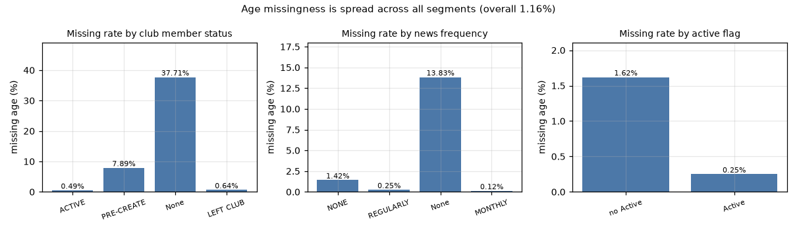
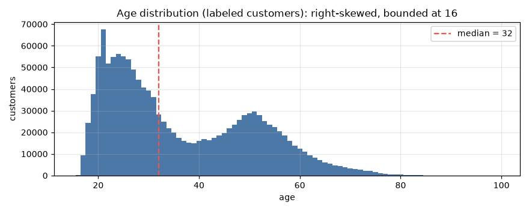
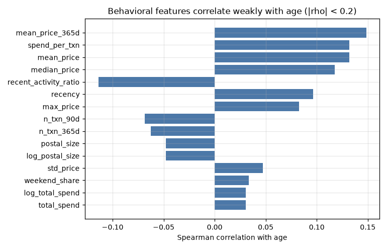
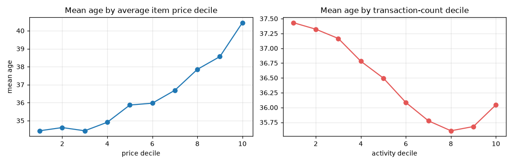
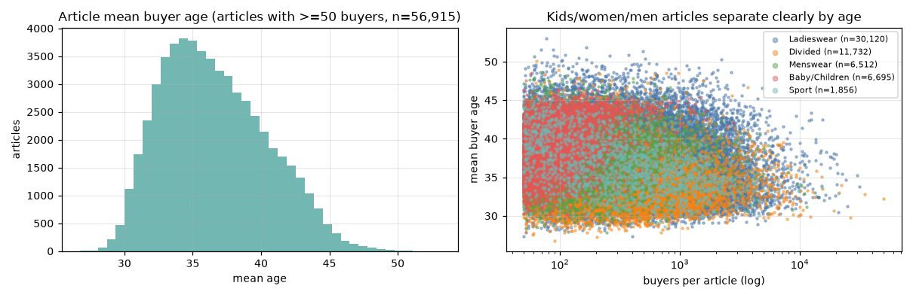
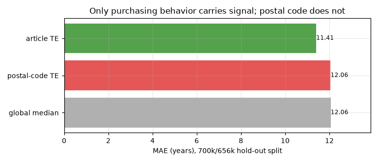
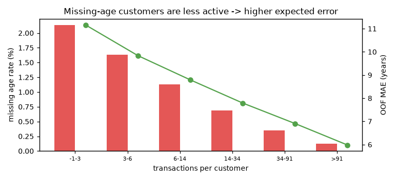
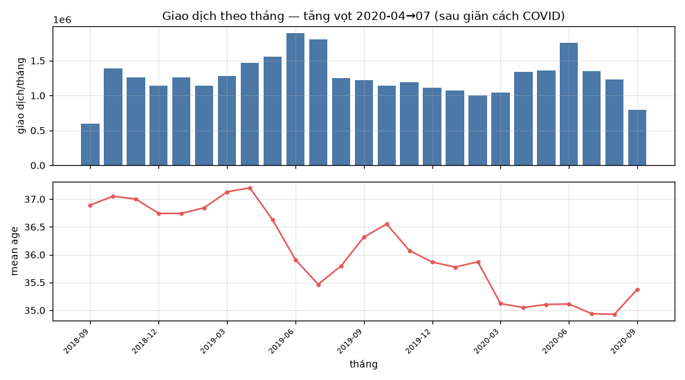

# EDA — H&M Personalized Fashion Recommendations (bài toán age imputation)

Báo cáo này là **bước 0**: phân tích dữ liệu trước khi chọn phương pháp.
Mọi lựa chọn thiết kế ở pipeline (`features.py`, `target_encoding.py`, `train.py`)
đều bắt nguồn từ các phát hiện dưới đây.

- Script: `src/eda.py` → số liệu tại `artifacts/eda_stats.json`, biểu đồ tại `reports/eda/`
- Dữ liệu: `customers.csv` (1.371.980 dòng), `articles.csv` (105.542), `transactions_train.csv`
  (31.788.324 giao dịch, 2018-09-20 → 2020-09-22)

## 1. Missingness của `age`

Tỷ lệ thiếu tổng thể: **1.16%** (15.861 khách).

| club_member_status | Số khách | Tỷ lệ thiếu age |
|---|---|---|
| ACTIVE | 1,272,491 | 0.49% |
| PRE-CREATE | 92,960 | 7.89% |
| (null) | 6,062 | 37.71% |
| LEFT CLUB | 467 | 0.64% |

| fashion_news_frequency | Số khách | Tỷ lệ thiếu age |
|---|---|---|
| NONE | 877,713 | 1.42% |
| REGULARLY | 477,416 | 0.25% |
| (null) | 16,009 | 13.83% |
| MONTHLY | 842 | 0.12% |

| Active | Số khách | Tỷ lệ thiếu age |
|---|---|---|
| không Active | 907,576 | 1.62% |
| có Active | 464,404 | 0.25% |

**Phát hiện:** thiếu age **không phải MCAR**. Tỷ lệ thiếu tăng vọt ở nhóm thiếu thông tin
tài khoản (`club_member_status` null: 37.71% so với
0.49% ở ACTIVE) và ở nhóm ít hoạt động
(median số giao dịch: nhóm thiếu = 4, nhóm có nhãn =
9; mean = 8.8 so với
23.3).

**Hệ quả:** các đặc trưng hành vi (vốn là nguồn tín hiệu chính) **yếu đi** đúng trên nhóm cần điền
→ sai số thực tế trên nhóm thiếu sẽ cao hơn sai số đo được trên nhóm có nhãn.

## 2. Phân phối `age`

| Chỉ số | Giá trị |
|---|---|
| n | 1,356,119 |
| mean / std | 36.39 / 14.31 |
| skew | 0.61 (lệch phải) |
| p1 / p5 / p25 / p50 / p75 / p95 / p99 | 18 / 19 / 24 / 32 / 49 / 62 / 71 |
| share 20–39 tuổi | 56.22% |
| share ≥ 50 tuổi | 23.45% |
| khách đúng 16 tuổi | 161 (0.012%) |
| tuổi phổ biến nhất | 21 (67,530), 24 (56,124), 20 (55,196), 25 (54,989), 23 (54,867), 26 (53,658) |

**Phát hiện:** target liên tục, lệch phải, giá trị nguyên; biên dưới bị chặn cứng ở 16 (rất ít
khách đúng 16 → không phải hiện tượng "dồn biên" đáng lo). Đuôi phải dài (p99 = 71) tạo outlier.

**Hệ quả:** dùng **hồi quy** (không phân loại thuần), **clip dự đoán về [16, 99]**, và chọn
**loss L1 (MAE)** vì metric quan tâm là sai số tuyệt đối và target có outlier.

## 3. Tín hiệu đơn biến của các đặc trưng hành vi

Spearman với age (mẫu 300.000 khách có nhãn):

| Feature | ρ |
|---|---|
| `mean_price_365d` | +0.148 |
| `spend_per_txn` | +0.132 |
| `mean_price` | +0.132 |
| `median_price` | +0.118 |
| `recent_activity_ratio` | -0.114 |
| `recency` | +0.097 |
| `max_price` | +0.083 |
| `n_txn_90d` | -0.069 |
| `n_txn_365d` | -0.063 |
| `postal_size` | -0.048 |
| `log_postal_size` | -0.048 |
| `std_price` | +0.047 |

- |ρ| lớn nhất: **0.148** (feature mạnh nhất thường là giá/đơn giá).
- Số feature có |ρ| > 0.1: **5** / tổng số feature số.

**Mean age theo nhóm hàng chiếm ưu thế** (khách mua chủ yếu nhóm nào):

| Nhóm hàng | Số khách | Tỷ lệ | Mean age | Median |
|---|---|---|---|---|
| Ladieswear | 1,019,110 | 75.68% | 36.7 | 32 |
| Divided | 196,866 | 14.62% | 32.8 | 27 |
| Baby/Children | 52,010 | 3.86% | 41.2 | 41 |
| Menswear | 50,963 | 3.78% | 38.6 | 36 |
| Sport | 27,571 | 2.05% | 37.1 | 33 |

**Mean age theo decile của giá và mức độ hoạt động:**

- Theo `mean_price` (thấp → cao): 34.4, 34.6, 34.4, 34.9, 35.9, 36.0, 36.7, 37.9, 38.6, 40.4 tuổi
- Theo `n_txn` (ít → nhiều): 37.4, 37.3, 37.2, 36.8, 36.5, 36.1, 35.8, 35.6, 35.7, 36.0 tuổi

**Phát hiện:** mọi đặc trưng RFM đơn lẻ đều rất yếu; quan hệ **không tuyến tính và không đơn điệu**
(tuổi tăng nhẹ theo giá, nhưng *giảm* rồi phẳng theo số giao dịch). Nhóm hàng tách tuổi tốt hơn
nhiều so với RFM (Divided: 32.8 tuổi vs Baby/Children: 41.2 tuổi).

**Hệ quả:** (a) không dùng hồi quy tuyến tính / điền bằng trung bình nhóm;
(b) cần mô hình cây (phi tuyến, bắt tương tác); (c) đầu tư vào đặc trưng **sở thích sản phẩm**,
không phải đặc trưng tần suất mua.

## 4. Tín hiệu ở mức article và postal_code

Article có "độ tuổi người mua" rất khác nhau (article ≥ 50 người mua): mean age trải từ
**29.8** đến **45.9** tuổi
(std = 3.8).

Kiểm định trên một split hold-out 700k/656k (fit encoding chỉ trên 700k):

| Phương pháp | MAE (tuổi) |
|---|---|
| Median toàn cục | 12.06 |
| Target encoding `postal_code` (alpha = 50) | 12.06 |
| **Target encoding `article_id`** (alpha = 10) | **11.41** |

- Tương quan giữa "article TE trung bình của khách" và age thực: **0.487**
  (so với |ρ| < 0.15 của mọi feature RFM).
- `postal_code`: 2.5 khách/mã, độ phủ 82.62% —
  nhưng **không giảm được lỗi** so với median.

**Phát hiện:** tín hiệu thật nằm ở **"món gì được mua"**, không phải "mua bao nhiêu" hay "ở đâu".

**Hệ quả:** xây **ma trận thưa khách × article** và **target encoding nhiều mức**
(article → department/product_type → section/index) với làm trơn Bayes, tính **theo từng fold**;
**loại `postal_code`** khỏi feature (chỉ gây nhiễu — đã kiểm chứng bằng thực nghiệm: bỏ nó giảm
MAE từ 10.25 xuống 8.83).

## 5. Ảnh hưởng của missingness lên sai số kỳ vọng

Chia khách theo số giao dịch; cột "MAE OOF" là sai số thực tế của mô hình trên từng nhóm:

| Số giao dịch | Số khách có nhãn | Tỷ lệ thiếu age | Cơ cấu nhóm thiếu | MAE OOF |
|---|---|---|---|---|
| 0–3 | 262,925 | 2.13% | 36.1% | 11.16 |
| 3–6 | 238,444 | 1.63% | 25.0% | 9.84 |
| 6–14 | 299,160 | 1.13% | 21.5% | 8.79 |
| 14–34 | 280,906 | 0.69% | 12.3% | 7.79 |
| 34–91 | 206,405 | 0.35% | 4.5% | 6.91 |
| 91+ | 68,279 | 0.12% | 0.5% | 5.98 |

- MAE trên nhóm **thiếu age (ước lượng theo cơ cấu hoạt động): 9.69 tuổi**
  — cao hơn MAE OOF tổng thể 8.800 vì nhóm này ít hoạt động hơn.

**Phát hiện:** sai số phụ thuộc mạnh vào lượng dữ liệu hành vi của từng khách (6.0 tuổi với khách
> 91 giao dịch so với 11.2 tuổi với khách ≤ 3 giao dịch).

**Hệ quả:** báo cáo trung thực MAE trên nhóm có nhãn (8.80) **và** MAE kỳ vọng trên nhóm thiếu
(~9.7); không tuyên bố 8.80 cho toàn bộ 15.861 khách thiếu.
Ngoài ra có thể xuất kèm độ tin cậy theo mức hoạt động nếu cần dùng cho phân tích hạ nguồn.

## 6. Chất lượng & trùng lặp đặc trưng

| Cặp feature | Spearman | Ghi chú |
|---|---|---|
| `total_spend ~ log_total_spend` | 1.000 | gần như trùng |
| `n_txn ~ total_spend` | 0.960 | gần như trùng |
| `n_txn ~ n_txn_365d` | 0.773 | gần như trùng |
| `Active ~ active_flag` | 1.000 | giống hệt |
| `mean_price ~ median_price` | 0.923 | gần như trùng |
| `postal_size ~ log_postal_size` | 1.000 | gần như trùng |

- `age` toàn bộ là số nguyên (100.0%), không có giá trị ngoài [16, 99].
- `Active` và `active_flag` **giống hệt nhau** → có thể bỏ một cột (không ảnh hưởng GBDT).
- `total_spend` và `log_total_spend` trùng thông tin (ρ = 1) nhưng GBDT bất biến với biến đổi đơn điệu
  → giữ cả hai không làm hỏng mô hình, chỉ tăng nhẹ số cột.

## 7. Kiểm tra chất lượng dữ liệu & xu hướng thời gian

| Kiểm tra | Kết quả | Hệ quả |
|---|---|---|
| Toàn vẹn tham chiếu (khoá mồ côi) | 0 lỗi customer_id, 0 lỗi article_id | Dữ liệu join nhất quán |
| Dòng giao dịch trùng hoàn toàn (5 cột) | **2.974.905 dòng (9,36%)**, tối đa 1 nhóm lặp 569 lần | **Không drop** — feature dạng tỷ trọng chỉ tăng trọng số đúng cường độ mua; bài dự báo doanh số thì phải xử lý |
| Cá voi (whale) | p99 = 187, p99.9 = 385, max = 1.895; 20 khách ≥ 1.000 giao dịch | Chấp nhận đuôi dài; GBDT chia theo ngưỡng nên không cần cắt |
| Toàn vẹn bảng | 9.699 khách không giao dịch; 995 sản phẩm chưa bán | vẫn dự đoán được bằng thuộc tính tài khoản |

**Xu hướng thời gian (2018-09 → 2020-09):** giao dịch **tăng vọt sau giãn cách COVID**
(2020-04 → 07, đỉnh 1,9 triệu giao dịch/tháng), và người mua **trẻ hoá dần**:
mean age từ 36.62 (12 tháng đầu) → 35.48 (12 tháng cuối), giảm 1.14 tuổi.

→ Hệ quả: cần feature **cửa sổ gần đây** (`n_txn_365d`, `mean_price_365d`, `recent_activity_ratio`)
vì phân phối người mua trượt theo thời gian; không dùng "thời điểm giao dịch" làm feature trực tiếp.

**Tín hiệu màu sắc (`colour_group_name`, chưa dùng trong model):** chênh mean age giữa các màu
phổ biến chỉ **5.4 tuổi** so với ~8 tuổi của nhóm hàng → **không đáng thêm**
20+ cột màu: tín hiệu trùng lặp với thông tin nhóm hàng.

## 8. Bảng quyết định: EDA → phương pháp

| Phát hiện từ EDA | Quyết định thiết kế |
|---|---|
| Target liên tục, lệch phải, có outlier, biên cứng 16 | Hồi quy + **loss L1 (MAE)** + clip về [16, 99] |
| RFM đơn lẻ yếu (\|ρ\| ≤ 0.15), quan hệ phi tuyến | **LightGBM** (cây, bắt tương tác), không dùng linear/mean imputation |
| Nhóm hàng tách tuổi tốt (32.8 vs 41.2) | Thêm **tỷ trọng mua theo category** + **target encoding** theo category |
| article TE giảm MAE 12.06 → 11.41, corr 0.49 | **Ma trận cust × article** + TE mức `article_id`, department, product_type... |
| `postal_code` không giảm lỗi | **Loại** postal_code khỏi feature |
| Thiếu age tập trung ở khách ít hoạt động (MNAR) | Báo cáo thêm MAE kỳ vọng trên nhóm thiếu (~9.7); cảnh báo selection bias |
| 31.788.324 giao dịch, RAM hạn chế | Polars streaming → Parquet gọn; X float32 + **memmap**; sample 700k/fold |
| Encoding phụ thuộc nhãn | TE tính **theo từng fold**, baseline postal cũng OOF |
| 9,36% dòng giao dịch trùng hoàn toàn | **Không drop** — feature dạng tỷ trọng chỉ tăng trọng số đúng cường độ mua |
| Người mua trẻ hoá theo thời gian + COVID | Cần feature cửa sổ gần đây (`n_txn_365d`, `recent_activity_ratio`) |
| Màu sắc tín hiệu yếu (chênh ~5 tuổi vs ~8 của nhóm hàng) | Không thêm cột màu — trùng thông tin nhóm hàng |

## 9. Kết luận

Dữ liệu **không cho phép** dự đoán tuổi chính xác cao: hành vi mua chỉ giải thích được khoảng
1/4 phương sai tuổi. Nhưng so với baseline median (MAE 12.07), mô hình đạt **MAE 8.800**
(−27%), đúng nhóm tuổi 43.6%. Giá trị của EDA ở đây là **tránh hai cái bẫy**:
(1) dùng `postal_code`/địa lý tưởng như có tín hiệu nhưng thực chất không có;
(2) tối ưu trên nhóm có nhãn rồi báo cáo như thể áp dụng được nguyên vẹn cho nhóm thiếu.
